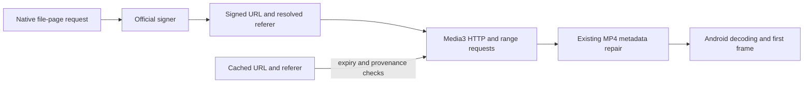

# Bunkr recovery investigation — 2026-11-15

## Baseline and acceptance

User-selected baseline: released ZEROCHILL 7.0.4,
`c4b9ad45fdacdb28347eb6ba7c369870006b3b23`. Continue draft PR #442,
`fix/bunkr-2026-11-search-playback-recovery`, inspected initially at
`2efaf959d5f03988963bb9262eca57f76948ae24`. This explicit selection supersedes
historical feature-candidate lineage in ZEROCHILL_BUILD_LINEAGE.md.

Native Balbums results and Bunkr first-frame playback/seek on the user's phone
are the acceptance criteria. Browser fallback, successful unit tests, an MP4
range response and a signed APK do not establish those criteria. Keep the PR
draft. No merge, tag, release, production deployment or publication is authorized.

Latest user correction: **gallery playback is fine; only search is down**.
This supersedes the earlier report that all gallery videos failed. Gallery-wide
playback failure is no longer an active symptom. It does not establish separate
seek/rotation/expiry checks or approval to merge or publish. Further repair work
must focus on native Balbums search and preserve the working gallery path.

## Search findings

The native route is Balbums `?search=<encoded query>&mode=broad&page=<n>`.
Jsoup follows HTTP redirects, applies the configured UA/approved headers/referer,
and reads Android WebView cookies. It does not execute verification scripts.
The parser expects album anchors matching the configured selector and recognized
Bunkr page origins. Albums then use server-side page URLs, `window.albumFiles`
metadata or file-link DOM, with an advanced-view fallback for older pages.

The inspected prior source-contract job confirms HTTP 403 on discovery and
search, before album parsing. Album/media checks in that job are consequential
failures because discovery supplied no album; they do not prove that all Bunkr
file pages or CDNs are blocked:
https://github.com/Addy37/ZEROCHILL/actions/runs/43661658009/job/132652104696

The user's Chrome success after verification is consistent with browser security
state that an unauthenticated HTTP client lacks. External Chrome/Custom Tabs and
Android WebView/Jsoup do not provide this app a shared cookie jar. Opening Chrome
is therefore a legitimate fallback, not native verification recovery. The current
HTTP evidence below identifies the checkpoint page; the clearance cookie/token
binding rules and a verified Chrome results response still require browser-side
observation. No such browser session was available in this workspace.

Fresh read-only CI evidence from source `a48582db`, 2026-11-15 02:17 UTC:

| Request | Observed result |
|---|---|
| Balbums index and search | 403, HTML, title `Checkpoint \| Sentinel`, Server `cloudflare`, no redirect |
| Recorded Bunkr file page | 200, modern `jsCDN`, `signUrl` and legacy file ID present |
| Official `glb-apisign.cdn.cr/sign?path=...` | 200 JSON containing `token` and `ex` |
| Signed `c3mb-b.cdn.cr` range | 206, 32 bytes, valid MP4 `ftyp`, Content-Range `bytes 0-31/492967736`, application/octet-stream |
| Recorded album page | 200, `window.albumFiles` and file links present |

The native JVM resolver/MP4-range/album-artwork contract ran one test with zero
skips and passed. This is not Android Media3 extraction, decoding or first frame.
The current checkpoint title contains a separator absent from the original
fixture; the detector and probe now recognize that exact title even on HTTP 200.
No source domain, signing route or album-format drift was observed for the
recorded sample. See the HTTP JSON and live XML in the candidate artifacts:
https://github.com/Addy37/ZEROCHILL/actions/runs/43664622918/artifacts/14142751301

This task's initial live curl requests failed at the environment proxy's CONNECT
policy (403 tunnel denial, no origin HTTP response). That is a separate layer from
the recorded upstream Balbums 403. Requested source-host grants were not yet
observed in environment revision 1. No route/domain/selector update is justified
from a proxy denial or the older fixtures alone.

Confirmed application defects addressed:

- 401/403/429 responses were retried automatically. Bunkr page resolution could
  then cycle to other configured origins. These outcomes and explicit verification
  HTML now stop the request chain and leave browser action to the user. Ordinary
  transport errors retain their configured bounded retry; maintenance fallback
  remains available.
- PR #442 described every search exception as a Bunkr block. Timeouts, parsing
  errors and temporary unavailability are not evidence of a security block. The
  browser action now uses accurate unavailable wording and makes no promise that
  external verification restores native access.

No challenge solving, browser impersonation, cookie extraction from Chrome,
verification proxy, automatic CAPTCHA action or alternate index is introduced.

Read-only inspection of the New Zerochill project's active source document on
2026-11-15 confirmed version 13, Bunkr enabled, and global fallbacks enabled.
Its complete Bunkr section is structurally identical to the bundled defaults,
including UA, headers, origins, selectors, signing route and timeouts. There is no
observed active server-side Bunkr configuration drift. The phone's cached snapshot
was not read. No configuration or backend data was changed.

## Playback findings

7.0.4 already implements the modern `jsCDN` + `signUrl` flow. It signs the decoded
CDN pathname, sends the file page's Origin/Referer without cookies to the signer,
then appends token/expiry while retaining unrelated CDN query parameters. Older
pages can use the legacy JSON download API, including its legacy decryption
format; page media elements/scripts provide a final direct-source fallback.
The gallery uses Media3, range-aware Bunkr data sources and the existing MP4
metadata repair. Those components were not rewritten.

`resolve` diagnostics identify failures before C. Player diagnostics identify
failures in D–F. The live 32-byte contract exercises requests and an MP4 header;
it does not exercise the complete gallery/player chain above.

Confirmed application defects addressed:

- If signing failed, `<video src=jsCDN>` could return the unsigned URL as a
  successful playable result. The script fallback excluded that URL, but the DOM
  fallback did not. Both now reject the unsigned signing candidate. Legacy direct
  embedded videos and genuine legacy API responses remain supported.
- On-demand gallery resolution cached the URL but omitted its resolver-provided
  request referer. Replay could consequently send the file-page referer instead of
  the legacy download referer. In-memory session restoration also discarded that
  header. URL and referer are now retained together on preload, normal resolution,
  recovery and gallery restoration. Old URL-only Bunkr entries are re-resolved.
- A late resolver exception could display a modal after the viewer swiped to a
  different file. The foreground failure callback now checks the current item.
- The gallery copied cookies from the Bunkr page/referer into requests to a
  different media CDN when that CDN had no cookies. Bunkr player requests now use
  only cookies scoped by CookieManager to the media URL, matching normal cookie
  domain boundaries. Existing other-provider behavior is retained. This is a
  confirmed request-header defect; it is not attributed to the remaining search
  failure. The user now confirms gallery playback is working.

The existing pager already rejects signed URLs within 30 seconds of expiry.
Tests now exercise this through the actual adapter, including preservation of
other-provider URLs. Expired Bunkr entries also lose their session metadata.
Disk session state never persisted resolved URLs; process recreation resolves
fresh URLs instead of persisting credentials or signing tokens.

The prior PR's scdn.st warm guard is retained as a bounded load mitigation. No
live concurrent-load evidence establishes that this alone fixes playback.
In particular, ordinary Bunkr album galleries have no creator query:
`preloadNeighbors` returns before `preloadVideo`, and the player uses the HTTP
factory directly rather than the creator-gallery cache. The warm suppression
therefore has **no effect on ordinary Bunkr album playback**; it only affects
Bunkr media reached through creator-gallery flows. The
player recovery path retains two bounded attempts for transient network failures.
Bunkr CDN 401/429 and fresh/unknown-signature 403 responses stop automatic recovery.
A 403 from a demonstrably expired signed URL permits one official URL refresh,
preserving the playback position. Unit coverage and device playback are separate
evidence.

The configured/bundled UA matches the current gallery UA. A remote header drift
could warrant a future Bunkr-gated factory change, but there is no verified drift
justifying changes to the shared provider factory here.

## Regression coverage and evidence collection

- BunkrResolutionTest: signing path/query/referer, genuine legacy/direct fallback,
  unsigned DOM rejection, denial without retries/mirror cycling/API fallback,
  verification HTML without mirror cycling, transport retries, maintenance versus
  empty results, cached expiry and warm selection.
- BunkrGalleryPlayableCacheTest: actual adapter expiry checks, other-provider cache
  preservation, session referer lifecycle, legacy URL-only cache invalidation and
  restored legacy referer reuse.
- SearchScopeTest: Bunkr results open the native album gallery, recent query
  retention, accurate unavailable/browser state, and isolation from other sources.
- BunkrPlaybackRecoveryTest: nested CDN denial causes, one expired-signature
  refresh, no fresh/malformed-signature retry, and unchanged other-provider and
  transient-network recovery decisions.
- BunkrGalleryResolutionLifecycleTest: a delayed on-demand resolver failure after
  a swipe must not display a stale modal or mark either page as failed.
- BunkrGalleryHttpHeadersTest: actual factory requests must not copy Bunkr page
  cookies across hosts; media-domain cookies and other-provider behavior remain.
- Existing gallery/recovery/parser tests and full Debug/Release unit suites run in
  the isolated candidate workflow. Focused regressions must pass before signing.
  A broader failure keeps the workflow red but permits a physical-test
  APK after focused success; it does not authorize merge or release.

`tools/bunkr_recovery_probe.py` records response status, redirect chains, selected
response headers, structural album/file metadata and official signing fields.
Signed tokens are redacted. It requests at most 32 video bytes and does not read a
full video if a server ignores Range. Requests are bounded and never solve or
retry a challenge. Its JSON is diagnostic evidence, not a pass/fail Android test.
The workflow retains this evidence even if unit tests fail.

Local focused regressions: 52 unique tests across resolver, repository, gallery
cache/guards, delayed resolution, cookie headers, recovery and search scope —
zero failures/errors/skips across the focused runs. The cookie tests capture real
Media3 factory requests over bounded loopback HTTP. JVM restrictions can suppress
Origin serialization, so they assert cookie scope and Referer, not Android Origin.

Beta 3 CI ran 1,787 Debug tests: one failure, four skipped, zero errors. The failure
was `ShitTokSpeedMuteTest.multiTouchAndRealPinchCancelHold` during Robolectric
native font setup (`FileSystemAlreadyExistsException`), before product assertions.
That unchanged class's eight tests passed when isolated locally. Release tests
did not run because Gradle stopped on Debug failure. Beta 3 produced no APK.
Beta 4 runs both variants with `--continue` to retain all results; signing remains
gated by focused success and the complete reports must be reviewed before merge.

### Final Beta 4 validation

Tested and signed source: `a48582db789057d3034aa8f876b132256619f67f`.
Workflow: https://github.com/Addy37/ZEROCHILL/actions/runs/43664622918

| Check | Result |
|---|---|
| Focused Bunkr/search/gallery regressions | 52 passed |
| Full Debug | 1,792 tests, zero failures/errors, four skipped |
| Full Release | 1,792 tests, one failure, zero errors, four skipped |
| Native resolver/MP4 range/artwork live contract | One passed, zero skips |
| Build and original certificate verification | Passed |
| Downloaded APK checksum, package/version, source revision and backend bytes | Passed |

The Release failure is the same unchanged
`ShitTokSpeedMuteTest.multiTouchAndRealPinchCancelHold` native font-loader
`FileSystemAlreadyExistsException`, during Robolectric application setup before
product assertions. The workflow remains **failed**, rather than hiding this
failure. It nevertheless exports the explicitly requested physical-test beta
after all focused checks pass. No merge is authorized with this outstanding
full-suite failure and the source-contract failures.

An isolated local **Release** rerun of all eight `ShitTokSpeedMuteTest` cases also
passed, with the exact Beta 4 version, source revision and V7 backend build
configuration verified from generated BuildConfig. The application code was
unchanged from the signed commit. This supports a full-suite Robolectric resource
setup/isolation failure; it does not change the failed CI result or waive it.

The source-contract run also remains failed: Bunkr discovery/search return the
checkpoint 403; EFukt has the same unrelated contract failures seen before this
repair; the other seven source probes and schema validation passed.
https://github.com/Addy37/ZEROCHILL/actions/runs/43664628314

## Compatibility and beta

No source-config document, backend, migration, database, preference format,
production package, permission, signing identity or other provider repository is
changed. Session referer metadata is process-local and optional. Existing
favorites, gallery content, downloads and stable installs are preserved.

Beta 4: `7.0.4-bunkr-beta.4`, version code `7000007`, separate package
`com.addy37.crazyshitunofficial.dev`, existing production certificate fingerprint
`04abf84b3d468cbb1a562dea83b0007e686b2e56018cce911223963faea51356`.
It uses the existing New Zerochill build routing and disables legacy analytics.
The filename includes branch and source SHA. Actions artifacts only; no release
asset or production publication.
The existing isolated workflow triggers on its own file change; subsequent source
updates require manual dispatch unless this candidate workflow is updated again.
Remove the one-off candidate workflow before any eventual production merge.

The downloaded APK is `ZeroChill-BunkrBeta-fix-bunkr-2026-11-search-playback-recovery-a48582d.apk`,
28,710,093 bytes. Its SHA-256 is
`e5751ff21539fe97c06239a000924bbff97d488666e5518e51e5bdb26930da23`.
Its actual version name is `7.0.4-bunkr-beta.4-dev`. `apksigner verify` passed;
the certificate, `.dev` package and code `7000007` were read from the downloaded
APK. DEX bytes contain the exact signed source revision and New Zerochill URL.
The archive hashes also match GitHub's artifact digests. Subsequent report-only
commits do not change this APK's source revision or application code.

## Current acceptance status

The user confirms galleries are working and identifies search as the only active
problem. The remaining product blocker is native Balbums search. The checks below
remain a regression/acceptance checklist; they are not a request to re-diagnose a
current gallery-wide failure. Merge/publication approval has not been given.

1. Search a known query in Bunkr and verify native cards/gallery open; record any
   denial separately from an empty result. Browser fallback must preserve the query.
2. Play a gallery video to first frame, seek near the end, pause/replay, rotate and
   return to the gallery. Exercise both a modern signed file and a legacy API file
   when available. Leave a gallery open until a signed URL expires and replay.
3. For a pre-player failure, copy the resolve diagnostics and confirm Open page
   opens the canonical file; external success does not imply native success.
4. Check a working other-provider gallery/video, favorites, a download and saved
   settings; stable must remain installed alongside the beta.

No claim of complete native recovery is warranted until these pass. Review all
source failures and test results before requesting merge approval.
